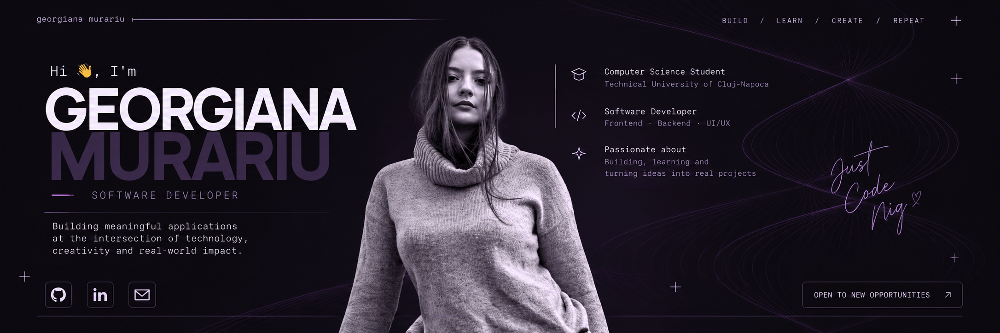

 

# 👋 Hi, I'm Georgiana!

**Computer Science Student · Software Developer · Creative Thinker**

Computer Science student focused on Software Engineering, Web Development and Distributed Systems.

Currently building projects with Java, Spring Boot, PostgreSQL, React, C/C++, Swift and Git.

 

---

### 🚀 Currently

- Building microservice-based applications with **Spring Boot**
- Working with **PostgreSQL** and REST APIs
- Developing web applications with **React**
- Learning more about distributed systems and software architecture
- Building personal projects to improve my software development skills

---

### 🛠️ Tech Stack

`Java` `C` `C++` `JavaScript` `React` `Spring Boot` `PostgreSQL` `HTML` `CSS` `Tailwind CSS` `Git` `GitHub`

---

### 🤝 Open to

- Software Engineering Internships
- Junior Developer opportunities
- Collaboration on interesting projects
- Open-source contributions
